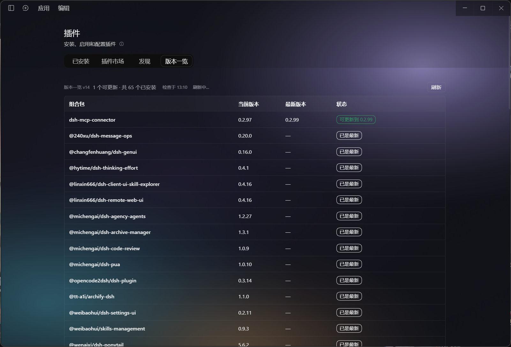

# 插件版本一览 · dsh-plugin-versions

给 DeepSeek Harness 的「插件」页加一个标签页：列出所有已安装组合包的版本，标出哪些能更新，点一行直接跳到官方组合包详情页的「版本」区块完成更新。

## 截图



## 它解决什么

DSH 官方的「版本」区块和更新按钮只出现在 **从 registry 安装、且被 Host 标为 `updatable`** 的第三方组合包详情页里。想确认「我这堆插件哪个该更新」，得逐个点进去看。这个插件把这件事摊平成一屏。

## 功能

- 插件页新增第 4 个标签页「版本一览」（`plugins.tab`，`order: 40`）
- 先渲染本地版本，再逐行后台查 registry；只查 `updatable && !official` 的行。检查走 3 路并发池（`CHECK_CONCURRENCY`，实测 6 个包 12.0s → 7.3s）：宿主内部每个包还会各自并发 4 路，外层压到 3 才不会一次打出几十个 `pnpm view` 子进程
- 后台重查的优先级：没有缓存的行最先查，其次按缓存时间从旧到新（每行单独记录 `at`）
- 结果缓存在 `localStorage`（`dsh-plugin-versions:cache:v1`）：再次打开先秒出上次的版本与状态，同时后台重新检查并逐行替换，表头显示「检查于 HH:MM」
- 状态分档：`可更新到 x` / `已是最新` / `随 DSH 更新` / `无官方版本区块` / 检查中… / 检查失败（附错误原文前 300 字）
- 可更新的行排前面，其余按包名排序
- 点一行 → `openPackage(name)` 打开官方组合包详情页，并自动滚到底，直接落在「版本」区块
- 详情页底部追加「↑ 回到顶部」（`plugins.detail.section`，`order: 999`）

更新动作本身完全走官方界面，本插件不实现任何更新流程。

## 安装

仓库即 bundle。二选一：

```bash
# 已在本机：用 DSH 的插件管理器装这个目录
plugin_manager install_bundle target=<绝对路径>/dsh-plugin-versions
```

或作为 npm 包安装到 profile（需先发到 registry）。注册靠 `cordis.patch.yml` 的 `- insert:` 一行，插件不会改写 profile 的任何文件。

## 结构

```
package.json          清单：dsh.bundle.patch / dsh.client / exports ./client
cordis.patch.yml      注册一行：- insert: [{ id, name }]
index.js              Host half（空实现，只为满足 bundle 契约）
client.js             浏览器半：纯 JS，window.__ModuleLoader__.load 懒加载工厂
locale/{zh,en}.json   显示元数据 meta.title / meta.description
icon.svg              列表图标
```

## 开发

客户端没有构建步骤：`client.js` 直接是产物，改完在「插件」页点刷新即可生效（`Ctrl+R` 在桌面端不触发重载）。渲染逻辑可以用 `vm` + 假 React 离线自证。

## 数据来源与权限

只读调用 Host 的 `pluginManager.listBundles()` 与 `pluginManager.listVersions(name, {})`。前者不触网；后者每个包最多打 2 个 registry（含 fallback 镜像），单包最坏约 140 秒，因此必须串行且只查可更新的行。

## 兼容性

清单里声明了 DSH 版本依赖：

```json
"engines": { "dsh": ">=0.2.0-rc.1 <0.3.0-0" }
```

宿主在安装、启用、以及列出可安装版本时会校验这个区间（`evaluatePluginCompatibility()`，预发布版也计入区间），不满足就拒绝装载，而不是装上去再炸。

字段层面还做了双兼容：DSH 0.2.2 起 `pluginManager.listBundles()` 把「能否更新」从布尔 `updatable` 改成了 `update: "registry" | "git"`，本插件两个字段都认（`updateKind()`），新旧宿主都不会把整张表判成「无官方版本区块」。

## 许可

MIT
